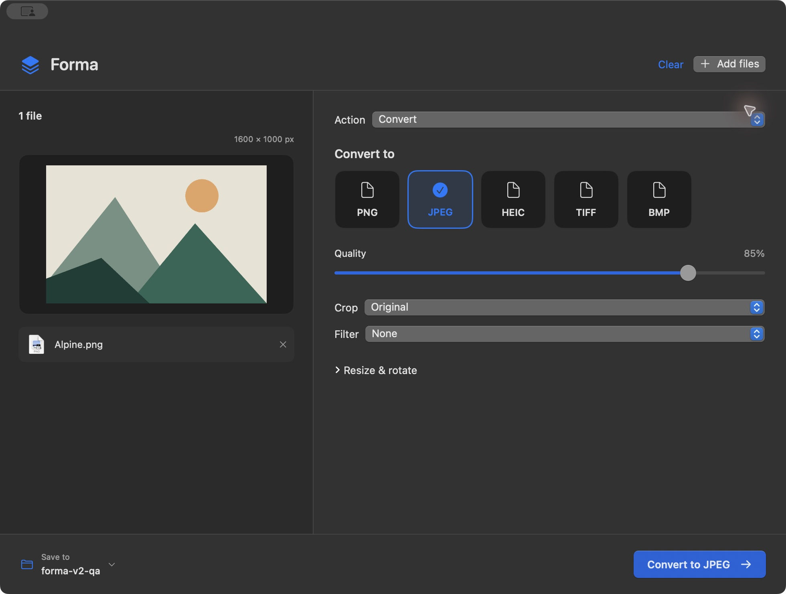
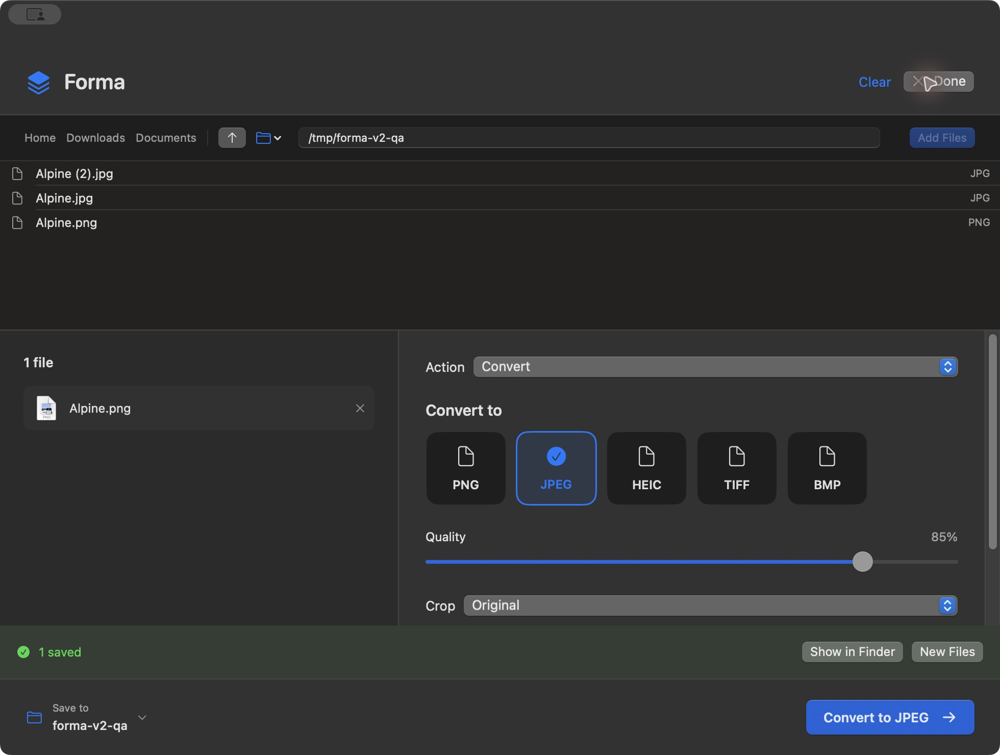

# Forma

Drop a file, pick a format, convert. Forma is a free, open-source Mac app for local conversions, image edits, PDF tools, and file organization.




## Get Forma

Download **Forma-macOS.zip** from [Releases](https://github.com/3nboyd/forma/releases), unzip, and move **Forma.app** into Applications. Requires **macOS 15 or later**. The downloadable binary is for **Apple silicon**; Intel users can build from source.

This community build is ad-hoc signed, **not Apple-notarized**. macOS may block first launch. Only if you trust this source, use System Settings → Privacy & Security → Open Anyway after attempting to open it. Building locally is another option.

## What's new in Forma 2

- One workspace: no tool sidebar or category tabs.
- Finder **Open With → Forma**, drag-and-drop anywhere in the workspace, or an inline folder browser.
- File detection shows compatible format tiles and actions automatically.
- Quality, crop, and filters stay close at hand. Resize, rotation, trim, and passwords expand when needed.
- Exports default to the source folder and get unique names.
- Mixed batches stay in the queue; select a file type to convert that group.

## Tools

| Tool | What it does |
| --- | --- |
| Images | Export PNG, JPEG, HEIC, TIFF, BMP; resize within a bounding box; centered aspect-ratio crop; rotate; nine photo filters; strip metadata |
| Audio & video | Export MP4, MOV, WebM, GIF, MP3, M4A, WAV, FLAC, OGG; trim; resize; quality controls where supported |
| Documents | Convert TXT, RTF, HTML, DOC, DOCX, ODT, WordML, WebArchive using macOS textutil |
| Merge PDFs | Combine PDFs in queue order, optionally selecting page ranges |
| Extract PDF pages | Save selected pages as separate PDFs |
| Lock PDF | Write a password-protected PDF |
| Unlock PDF | Remove encryption with the existing password |
| PDF to text | Extract selectable text |
| PDF to images | Render each selected page to PNG or JPEG |
| Copy files | Copy files and folders to a chosen destination |
| Move files | Move files and folders on the same disk without making a second copy; requires confirmation |
| Create ZIP | Bundle files and folders using macOS ditto |

Audio and video tools require [FFmpeg](https://ffmpeg.org/). Install separately with `brew install ffmpeg`. Forma detects `/opt/homebrew/bin/ffmpeg` and `/usr/local/bin/ffmpeg`. FFmpeg is not bundled or downloaded by the app.

## How to use

1. Drop files into Forma, or right-click them in Finder and choose **Open With → Forma**. **⌘O** opens the inline browser.
2. Click an output-format tile. Relevant settings appear automatically.
3. Click **Convert** or press **⌘Return**. Results save alongside the source unless you choose another folder.

The action menu exposes the other tools available for the selected files. For a mixed batch, use the small file-type filters to select a convertible group. **Browse** opens the embedded folder browser; enter a folder path to reach other locations or external disks. Finder discovers the app after it is placed in Applications and opened once; **Open With → Other…** can select it if the menu has not refreshed.



Conversions preserve originals. Existing destination names get numbered suffixes. Failed conversions clean up staged files. Moving renames the original file instead of copying and deleting it, so applications with the file open can continue editing it at its new location. If a batch move fails, Forma attempts to restore completed moves without overwriting anything and reports preserved locations if restoration cannot finish. Moving between disks is intentionally unsupported; copy and verify your files instead.

## Honest limits

- Supported output formats are listed in the interface. This is not a universal converter for arbitrary file types.
- Image input decoding depends on macOS ImageIO. Animated and multipage image inputs use the first frame only. HEIC output availability depends on the system encoder.
- Crops use centered presets; there is no freehand crop selection. Image exports are rendered through Core Image and are not promised to preserve all HDR, RAW, color-profile, or professional editing information.
- JPEG uses a white background for transparent images. Quality controls primarily affect lossy formats; lossless formats preserve their encoding characteristics.
- PDF text extraction does not perform OCR. Converting a PDF back into an editable Word document is not supported. Unlocking requires the password; it does not crack encryption.
- Document layout fidelity depends on macOS textutil. Complex Office documents may change appearance. External HTML resources are not loaded, and FFmpeg network protocols are disabled. Spreadsheet and presentation conversion, RTFD bundles, archive extraction, and cloud transfers are not supported.
- Operations run locally in the background with an indeterminate activity indicator and no mid-operation cancel. Large batches may need significant temporary disk space.
- PDF passwords are used in memory for the current operation and are never written to app preferences or logs. Clear the password field after use if you share your screen.

## Build and test

With a current Xcode toolchain (Swift 6 or later):

```sh
swift test
bash scripts/build-app.sh release
open dist/Forma.app
```

The packaging script creates `dist/Forma.app` and `dist/Forma-macOS.zip` and signs the bundle ad-hoc. No external Swift packages are required. CI tests and packages on macOS.

Integration tests exercise actual image output dimensions, PDF merge/split/encryption, trim output duration, collision-safe copy/move, invalid batches, recursive destination rejection, document conversion, and ZIP creation.

## Privacy and license

Forma has no analytics, server, updater, or network client. It invokes local system tools and an independently installed FFmpeg. File selection and output location remain under your control. Review source before handling sensitive files.

MIT licensed. Built independently; not affiliated with Tangerine or Apple. See [LICENSE](LICENSE).
